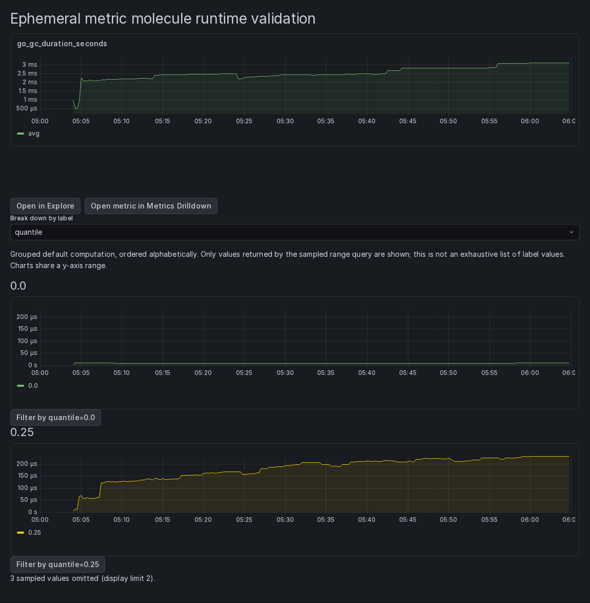

# Composable metrics components

Metrics Drilldown exposes three focused components for Assistant pages and other Grafana hosts. Unlike the existing `MiniBreakdown`, `LabelBreakdown`, and `SourceMetrics` embeds, these components do not mount a `DataTrail`, own the browser URL, or inherit saved metric configuration. They run inside Grafana using its datasource, visualization, and theme services—not as standalone applications outside Grafana.

Consume them through Grafana's `usePluginComponent<Props>(id)` API. Declare consumed component IDs in the host plugin's `dependencies.extensions.exposedComponents`. The runtime contract is described below; this feature does not publish a separate npm package.

| ID                                                       | Capability                                                             |
| -------------------------------------------------------- | ---------------------------------------------------------------------- |
| `grafana-metricsdrilldown-app/metric-chart/v1`           | One metric with automatic type-aware query and visualization selection |
| `grafana-metricsdrilldown-app/metric-value-breakdown/v1` | One selected label's sampled values, rendered as comparable charts     |
| `grafana-metricsdrilldown-app/metric-handoff/v1`         | Explicit-context links to Explore and full Metrics Drilldown           |

The plugin requires Grafana 13.3 or newer, as specified in `src/plugin.json`.

## Shared scope

The chart and breakdown accept:

```ts
interface MetricSceneOptions {
  dataSourceUid: string;
  from: string | number;
  to: string | number;
  metric: string;
  filters?: AdHocVariableFilter[];
  customRateInterval?: string;
}
```

- `dataSourceUid` identifies a Prometheus-compatible datasource.
- Numeric times are epoch milliseconds. String times can be Grafana date math, such as `now-1h`/`now`, or date strings. `from` must not follow `to`.
- `metric` is an explicit metric name, not a PromQL expression. Ordinary dotted and UTF-8 names are supported. Names containing control characters, quotes, backslashes, braces, template dollars, or legacy `[[` template openers are not supported by this v1 selector boundary.
- Filters are single-value `=`, `!=`, `=~`, or `!~` matchers with AND semantics. Undefined, empty/default, and `AND` conditions are accepted. Multi-value filter objects and OR/group semantics are not supported. Filter values are literals, not Grafana templates. A conflicting `__name__` matcher is not accepted by chart/breakdown.
- `customRateInterval` is an optional positive Prometheus duration, such as `5m` or `1h30m`. Otherwise the existing datasource-aware `$__rate_interval` default applies. Do not use an arbitrary query fragment or template as an override.

Scope is explicit and instance-local. Hosts must map service identities to appropriate metric labels; the components do not assume `job`, `service_name`, and `container_name` are interchangeable. Narrow scopes may exclude dependency metrics. Insufficient samples can still produce no data, even with a valid rate interval.

## MetricChart

Source contract: `src/exposedComponents/MetricChart/MetricChart.tsx`.

Additional optional prop:

```ts
onQueriesChange?: (queries: PromQuery[]) => void;
```

The component reuses Metrics Drilldown's type detection, metadata lookup, native-histogram probing, and panel/query builders. It does not expose arbitrary custom functions or a generic PromQL editor in v1.

The callback reports current query targets after metric-type resolution. Molecule-local variables are expanded, app-only usage labels are removed, and built-in Grafana macros such as `$__rate_interval` remain for datasource execution. Literal dollar characters and legacy template markers inside filter values are represented with PromQL-safe escapes. Do not reinterpret these expressions as templates or reconstruct them from the metric name.

Keep returned targets associated with the same scope that produced them. When changing the datasource, metric, filters, or time range, clear any retained handoff targets or remount the host investigation with a scope key. Callback cleanup prevents future emissions from an old scope; it does not erase state already stored by the host.

## MetricValueBreakdown

Source contract: `src/exposedComponents/MetricValueBreakdown/MetricValueBreakdown.tsx`.

Additional props:

```ts
interface BreakdownOptions {
  label: string;
  onLabelChange: (label: string) => void;
  onFilterSelect?: (filter: AdHocVariableFilter) => void;
  onQueriesChange?: (queries: PromQuery[]) => void;
  maxValues?: number;
}
```

The label picker is controlled: update `label` in response to `onLabelChange`. Like the app's breakdown picker, it excludes reserved `__name__` and `le` dimensions. Selecting a value emits its actual matcher through `onFilterSelect`; the host decides how to update filters. Empty values remain empty matcher values, not display placeholders.

The molecule queries the existing type-aware grouped default computation and renders static panels from those results. It does not issue one range query per value or apply per-value saved preferences. Histogram breakdown uses the existing default grouped sum computation. Metadata discovery and a native-histogram probe may add requests.

Values are ordered alphabetically. `maxValues` defaults to 6, must be a positive integer, and is capped at 24. Displayed charts share y-axis bounds. An omitted-value notice identifies truncation.

**This is a sampled-value view, not an exhaustive label-value catalog.** Values absent from the range-query response cannot be listed. Returned frames without usable samples are not presented as zero. The display cap limits panel rendering; it does not guarantee a backend series/cardinality limit for the grouped query.

## MetricHandoff

Source contract: `src/exposedComponents/MetricHandoff/types.ts`.

```ts
interface MetricHandoffProps {
  dataSourceUid: string;
  from: string | number;
  to: string | number;
  queries: PromQuery[];
  metric?: string;
  filters?: AdHocVariableFilter[];
  groupBy?: string;
}
```

- **Explore:** uses the supplied query targets, preserving expressions and query options. Targets must have unique, nonempty `refId`s and reference the supplied datasource (or omit their datasource). Pass chart/breakdown callback targets directly. `filters` are not added again to Explore expressions.
- **Metrics Drilldown:** appears only when valid explicit `metric` context is supplied. Opens that metric with filters, time, and optional grouping using Drilldown defaults. It does **not** promise to preserve the Explore expressions, arbitrary functions, or chart rate overrides. No expression is parsed to guess a metric.
- Both links respect Grafana subpath installations. They are ordinary accessible links; the component does not mutate host state or the current browser URL while rendering.

Unsupported optional Drilldown context suppresses that destination without discarding valid Explore navigation. V1 rejects template-containing names and unsupported filter shapes. Literal reserved Scenes URL escape tokens (`__gfp__`, `__gfc__`, `__gfh__`) in filter keys/values cannot be represented losslessly by the destination and suppress the Drilldown link. Values equal to the literal two-quote string `""`, or containing dollar/legacy variable syntax, also suppress Drilldown because its existing formatter would reinterpret them after decoding. Normal commas, hashes, pipes, regexes (including a trailing `$` anchor), and empty filter values are preserved. These limitations do not affect the chart/breakdown's literal filters or the handoff's exact Explore targets.

## Minimal host composition

The following runtime preview mounts all three components against Grafana 13.3 and a fixture datasource. It is an illustrative composition, not a production Assistant page.



After resolving the components through `usePluginComponent` and handling its loading/unavailable states, compose them with one explicit scope:

```tsx
// Keep this state inside an investigation keyed by datasource/metric/time/filters.
const [queries, setQueries] = useState<PromQuery[]>([]);
const [label, setLabel] = useState('instance');

return (
  <>
    <MetricChart {...scope} onQueriesChange={setQueries} />
    <MetricValueBreakdown {...scope} label={label} onLabelChange={setLabel} onFilterSelect={handleSelectedFilter} />
    <MetricHandoff {...scope} queries={queries} groupBy={label} />
  </>
);
```

Here Explore receives the main chart's targets. To hand off the grouped breakdown query instead, retain that component's `onQueriesChange` output separately. Each callback output belongs to its originating scope and computation.

## Deliberately deferred

Scoped metric discovery/catalog extraction, histogram threshold contribution, automatic all-label fan-out, dashboard export, alert creation, and a shared cross-signal host framework are not part of this first slice.
